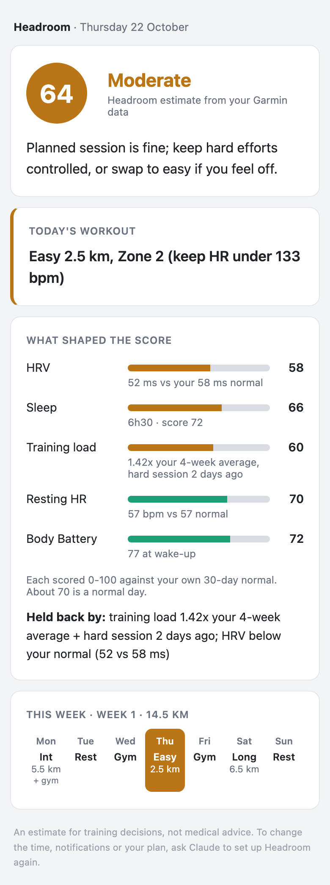
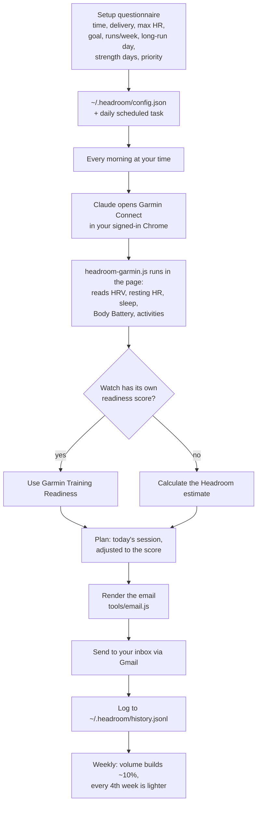

# Headroom

**A morning check-in that tells you how hard to train today, and why.** Headroom reads the recovery data your watch already records, scores it against your own normal, and emails you a readiness score with today's workout from a running plan built around your strength days. It runs on your own Claude, against your own Garmin account. No app, no server, no account to create.

<p align="center">
  
  <br>
  <sub>The morning email, shown with sample data.</sub>
</p>

## Why this exists

Most running injuries aren't accidents. They're overuse: the body's tendons, bones and muscles get more work than they've adapted to, usually for a few weeks in a row, and something gives. The pattern is familiar to anyone who has trained for a race. A good few weeks, a jump in distance, a hard session on a short night's sleep, and then a sore Achilles that takes a month to settle.

The warning signs tend to show up in data before they show up as pain:

- **Load climbing faster than you've adapted to it.** In a study of novice runners, those who increased weekly distance by more than 30% over two weeks appeared more vulnerable to distance-related injuries than those who stayed under 10% ([Nielsen et al., 2014](https://pubmed.ncbi.nlm.nih.gov/25155475/); the effect was borderline, but it's the origin of much of the "10% rule" thinking). The wider idea, comparing the last week's load with your recent average (the acute:chronic ratio), comes from sports science work on load and injury ([Gabbett, 2016](https://pubmed.ncbi.nlm.nih.gov/26758673/)).
- **Recovery that hasn't caught up.** Overnight heart rate variability (HRV) dropping below your own normal, and resting heart rate creeping up, are signs your body is still dealing with the last few days. Training that follows HRV, going hard when it's normal and easing off when it's suppressed, has produced the same or better fitness gains as a fixed plan ([Vesterinen et al., 2016](https://pubmed.ncbi.nlm.nih.gov/26909534/)).
- **Short sleep.** Adolescent athletes sleeping under 8 hours had a higher injury rate than those who slept more ([Milewski et al., 2014](https://pubmed.ncbi.nlm.nih.gov/25028798/)).

Higher-end watches turn these signals into a single daily number (Garmin calls it Training Readiness). Many good watches, such as the Forerunner 165, record every input but never combine them. Headroom does that combining, and then does the one thing a number alone doesn't: it changes what you're told to do today.

**What it is honest about:** no score prevents injuries. Headroom flags the conditions that make them more likely, so you can ease off on the days that matter. The acute:chronic ratio is a useful rule of thumb, not a law (its predictive power has been questioned, e.g. [Impellizzeri et al., 2020](https://pubmed.ncbi.nlm.nih.gov/32502973/)), and the weights in the score are a reasoned starting point, tuned with your own feedback over time.

## What you get each morning

An email (and optionally a push notification) at the time you choose:

1. **Readiness score, 0-100**, coloured by band, with one line on how to approach today.
2. **Today's workout**, taken from your plan and adjusted to the score. On a Low day, intervals become an easy run and the long run gets shorter. On a Poor day, it's rest. The email shows what was planned so you can see what changed.
3. **What shaped the score**: HRV, sleep, training load, resting HR and Body Battery, each against your own 30-day normal, and the one or two things holding you back.
4. **This week at a glance**, with today highlighted.

If the check can't run (your watch hasn't synced, or the Garmin session expired), you still get a short email saying so. No email means the run itself didn't happen.

## The workflow



### 1. Setup (once, about two minutes)

Ask Claude to **set up Headroom**. It looks at your last 90 days of Garmin data first, so most answers are pre-filled, then asks two short rounds of questions:

- **The morning check:** what time, how to reach you (email, push or both), whether to notify every morning or only on Low or Poor days, and your max heart rate (it suggests the highest from your recent activities).
- **Your training:** goal (5K, 10K, half marathon or general fitness), runs per week, long-run day, which days you do strength training, and whether running, strength or neither comes first.

It saves your answers, shows you the week's plan, schedules the daily check and runs it once so you see a real email straight away.

### 2. Every morning

The scheduled task opens Garmin Connect in your browser, runs the Headroom script in the page and reads only what it needs. The score and the plan are calculated by tested code; Claude runs it and delivers the result exactly as rendered, so the numbers can't drift or be made up. The whole run takes a few minutes and closes its tab when it's done.

### 3. Over the weeks

Each run is logged. When you check in with Claude yourself, it asks whether the score matched how you felt. That 👍/👎 log is what the weights get tuned against. Your weekly distance builds by about 10% a week from where you actually are, with a lighter week every fourth week.

## How the score works

**If your watch has its own readiness score, Headroom uses it.** On Garmin watches with Training Readiness (many newer Forerunner, Fenix and Epix models), the morning email shows Garmin's score and says so. The Headroom estimate is still calculated and logged alongside it, which is a useful check on the formula. Fitbit's Daily Readiness isn't among the Google Health API's data types today, so Fitbit and Pixel Watch users would get the Headroom estimate.

Otherwise, Headroom calculates its own. Each part is scored 0-100 against your own 30-day history, where about 70 is a normal day for you:

| Component | Weight | How it's scored |
|---|---|---|
| HRV | 30% | Last night vs your 30-day baseline; marked down when your 7-day average drops below your Balanced range |
| Sleep | 25% | Last night's sleep score (60%) plus your 3-night average duration against 8 hours (40%) |
| Training load | 25% | Last 7 days of load vs your 4-week average, using time in heart-rate zones. 0.8-1.3x is on track; above 1.3x it falls steadily to zero at 2.0x. Marked down the day or two after a hard session |
| Resting HR | 15% | This morning vs your 30-day baseline |
| Body Battery | 5% | Level at wake-up |

**Safety caps.** If your resting HR is 7 or more bpm above normal, or Garmin's HRV status reads Low, the score is capped at 30, however good everything else looks. Those are often the first signs of illness or real fatigue. With less than 14 days of history it says "calibrating" instead of guessing.

| Score | Band | Guidance |
|---|---|---|
| 75-100 | High | Good day for intervals or a time trial |
| 50-74 | Moderate | Planned session is fine; swap hard for easy if you feel off |
| 25-49 | Low | Easy and short, or cross-train |
| 0-24 | Poor | Rest |

## How the plan protects you

The plan only schedules running and two short bodyweight "runner strength" blocks a week (calf raises, heel drops, split squats, glute bridges, core). Your strength training is yours: Headroom only needs to know which days you do it, never what's in it.

- **It starts from your real volume,** not your best week, and builds about 10% a week with a lighter week every fourth.
- **Hard runs are at least 48 hours apart,** and avoid the day after strength training when the week allows it. When they share a day, the plan says to run first and lift later.
- **Low weekly volume gets one hard run, not two,** because warm-ups and cool-downs add up.
- **The long run builds from your longest recent run,** so a few light weeks don't reset you to beginner distances.
- **A Low readiness score only ever shortens or softens a run,** never lengthens it.

## Install

You need the Claude desktop app or Claude Code, with Claude in Chrome and a Gmail connection for email delivery. Node 18+ is only needed to run the tests.

```bash
claude plugin marketplace add <path-or-git-url-of-this-repo>
claude plugin install headroom@headroom
```

Then ask Claude to **set up Headroom**.

A few practical notes:

- The check runs on your computer, because it uses your Chrome session. Pick a time when the computer is usually awake and the Claude app is open; a run that's missed happens the next time you open the app.
- Scheduled runs are unattended, so approve the tools once: open the scheduled task, click **Run now**, and choose "always allow" for connect.garmin.com.
- Your watch needs to have synced overnight through your phone.

## Privacy

There's no Headroom server. Your Garmin data goes from Garmin to your browser to your Claude session, and the email goes only to the address you gave during setup. Headroom never sees or stores your password: it uses the Garmin session you're already signed in with. Your history and settings stay in `~/.headroom/` on your computer.

## Under the hood

```
skills/setup        questionnaire → config, plan preview, schedule
skills/readiness    morning check, backtest, weekly plan
src/adapters/              Garmin (browser session) → common data format
src/core/readiness.js      the score
src/core/plan.js           weekly plan + today's session
src/email/render.js        the morning email (email-safe HTML + plain text)
tools/                     build, score, plan, email, preview
```

The core never talks to Garmin directly. Adapters turn each source into one common format, so adding another source (such as the Google Health API for Fitbit and Pixel Watch) means writing an adapter, not touching the score or the plan:

```json
{
  "source": "garmin",
  "days": [
    { "date": "2026-10-22", "restingHr": 58, "hrvLastNight": 52, "hrvWeeklyAvg": 55,
      "hrvStatus": "BALANCED", "hrvBalancedLow": 49, "hrvBalancedHigh": 64,
      "sleepSeconds": 23400, "sleepScore": 72, "bodyBatteryWake": 77,
      "deviceReadiness": null }
  ],
  "activities": [
    { "start": "2026-10-20T07:30:00", "type": "running", "durationS": 1800, "distanceM": 5000,
      "avgHr": 165, "maxHr": 184, "aerobicTe": 3.6, "label": "VO2MAX",
      "zoneSeconds": [90, 300, 480, 720, 210] }
  ]
}
```

Every field except `date` and `start` is optional.

```bash
npm test                                  # 35 tests, synthetic data only
npm run build                             # bundle src/ into the page script
node tools/score.js data.json --backtest 30
node tools/plan.js                        # this week's plan from your config
node tools/email.js result.json           # render a morning email
```

## Known limits

- **Unofficial endpoints.** The Garmin adapter reads the same internal endpoints the Garmin Connect website uses. They can change without notice, and automated access sits outside Garmin's official API. Headroom is read-only and limited to your own account.
- **Cost per run.** Each check pastes a ~28 KB script into the page, which uses some of your Claude usage every morning. An MCP server or Garmin's official API would remove that.
- **Untested on watches with Training Readiness.** Using Garmin's own score is written defensively but hasn't yet run against a watch that has it.
- **The weights aren't validated.** They were checked against one runner's 60-day history, where personal bests fell on high-scoring days and the worst mornings scored lowest. That's encouraging, not proof.

## Roadmap

- Post-run debrief: splits, pacing and form compared with your past runs at the same pace
- Google Health API adapter for Fitbit and Pixel Watch
- Tuning the weights from the 👍/👎 log

Headroom is an estimate for training decisions, not medical advice. If something hurts, see a physio.
