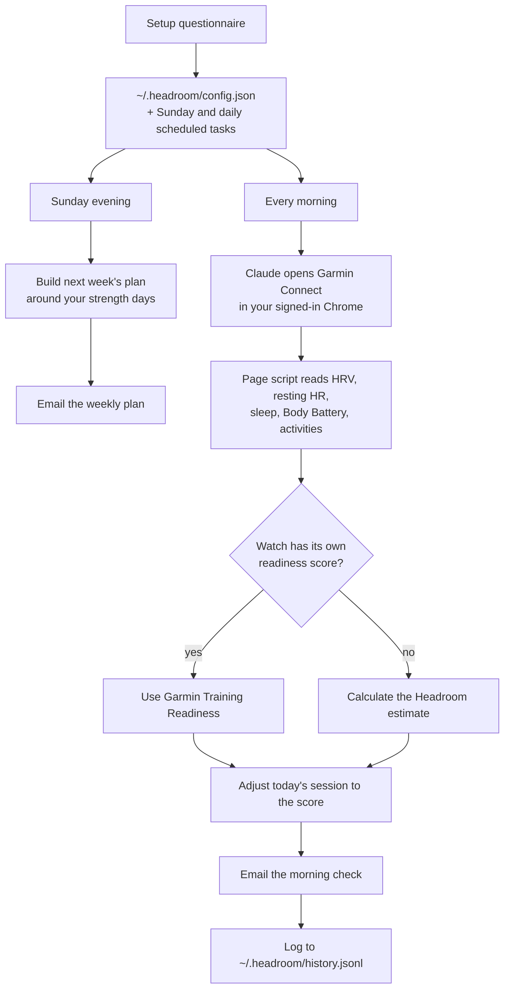

# How Headroom works

## The research behind it

Most running injuries are overuse. They build over weeks, and the warning signs show up in data before they show up as pain:

- **Distance jumps.** Novice runners who added more than 30% in two weeks were more vulnerable to injury than those who stayed under 10% ([Nielsen et al., 2014](https://pubmed.ncbi.nlm.nih.gov/25155475/)).
- **Load spikes against your recent average** ([Gabbett, 2016](https://pubmed.ncbi.nlm.nih.gov/26758673/)).
- **Recovery that hasn't caught up:** HRV below your normal, resting heart rate creeping up. Training that follows HRV matched or beat a fixed plan ([Vesterinen et al., 2016](https://pubmed.ncbi.nlm.nih.gov/26909534/)).
- **Short sleep:** athletes sleeping under 8 hours were injured more often ([Milewski et al., 2014](https://pubmed.ncbi.nlm.nih.gov/25028798/)).

No score prevents injuries, and the acute:chronic ratio has its critics ([Impellizzeri et al., 2020](https://pubmed.ncbi.nlm.nih.gov/32502973/)). Headroom flags the conditions that make injury more likely, so you can ease off on the days that matter.

## The flow



The Sunday email needs only your config, so it arrives even if your Garmin session has expired. Every number, in both emails, comes from tested code. Claude runs it and sends the result exactly as rendered.

## The plan

Headroom schedules your runs and two 12-minute bodyweight runner-strength blocks a week (calf raises, heel drops, split squats, glute bridges, core). Your gym sessions are a black box: it only needs to know which days you train.

- **Starts from your real volume,** not your best week, and builds about 10% a week, with a lighter week every fourth.
- **Hard runs are at least 48 hours apart** and kept off the day after strength training when the week allows. When they share a day: run first, lift later.
- **One hard run, not two, below 15 km a week,** because warm-ups and cool-downs add up.
- **The long run builds from your longest recent run,** so a few light weeks don't reset you.
- **Paces come from your current race time,** using Jack Daniels' VDOT model: easy at about 62-70% of your VDOT, tempo at 88%, intervals at 97.5%. Heart-rate limits stay as a backstop. When you run faster, update your current time and every pace moves with you.
- **A Low readiness score only ever shortens or softens a run,** never lengthens it.

## Beginner mode

For people who can't yet run 20 minutes non-stop. Fourteen run/walk stages take them from 8 x (run 1 min, walk 1.5 min) to 30 minutes non-stop. Each stage is a week of two or three sessions, spaced around strength days.

**Why it's built this way:**

- **New runners are the highest-risk group.** Novices get about 17.8 injuries per 1,000 hours of running, against 7.7 for recreational runners, with the risk concentrated in the first 8-13 weeks ([Videbæk et al., 2015](https://pubmed.ncbi.nlm.nih.gov/25951917/)).
- **Rigid programmes lose people.** In a Couch to 5K study, 19% were injured and only 27% finished. Dropouts blamed the speed of progression, especially week 5 (5, then 8, then 20 minutes), and a previous injury made dropping out 7.6 times more likely ([Couch to 5K study, 2023](https://pmc.ncbi.nlm.nih.gov/articles/PMC10487403/)). So Headroom's longest continuous run never grows more than 50% in a stage, and moving up depends on how the last week went.
- **Run/walk is easier on the body.** A run/walk strategy gave similar finish times with less muscle pain and fatigue ([Hottenrott et al., 2016](https://pubmed.ncbi.nlm.nih.gov/25467199/)). This was in marathon runners and measured discomfort, not injuries.
- **Strength training is the best-supported protection.** It cut sports injuries to under a third and nearly halved overuse injuries in a meta-analysis of 25 trials; stretching showed no effect ([Lauersen et al., 2014](https://pubmed.ncbi.nlm.nih.gov/24100287/)). Every plan includes two short bodyweight strength blocks a week.

**What it doesn't claim.** A slower programme on its own didn't reduce injuries: a 13-week plan following the 10% rule had no fewer than a standard 8-week plan ([Buist et al., 2008](https://pubmed.ncbi.nlm.nih.gov/17940147/)), and a 4-week walking-and-hopping lead-in had no effect ([Bredeweg et al., 2012](https://pubmed.ncbi.nlm.nih.gov/22842237/)). Headroom's bet is flexibility: move up when the body is ready, repeat when it isn't. That matches what dropouts asked for, but whether it reduces injuries hasn't been tested.

**How progression works.** Each Sunday, Headroom reads last week's morning checks. It moves you up a stage when you ran at least twice and had fewer than two Low or Poor mornings (fewer than one after a recent injury). Otherwise it repeats the stage. On a Low morning, that day's session drops back to the previous stage; on a Poor morning, it's a walk. After stage 14, setup runs again to switch to the regular plan with paces.

## The readiness score

If your watch has its own readiness score (Garmin Training Readiness on many newer Forerunner, Fenix and Epix models), Headroom uses it and still logs its own estimate alongside. Fitbit's Daily Readiness isn't in the Google Health API today.

Otherwise, each part is scored 0-100 against your own 30-day history, where about 70 is a normal day:

| Component | Weight | How it's scored |
|---|---|---|
| HRV | 30% | Last night vs your 30-day baseline; marked down when your 7-day average drops below your Balanced range |
| Sleep | 25% | Last night's sleep score (60%) plus your 3-night average duration against 8 hours (40%) |
| Training load | 25% | Last 7 days vs your 4-week average, from time in heart-rate zones. 0.8-1.3x is on track; above that it falls to zero at 2.0x. Marked down for a day or two after a hard session |
| Resting HR | 15% | This morning vs your 30-day baseline |
| Body Battery | 5% | Level at wake-up |

Resting HR 7+ bpm above normal, or an HRV status of Low, caps the score at 30. With less than 14 days of history it says "calibrating" instead of guessing.

| Score | Band | Today |
|---|---|---|
| 75-100 | High | Good day for intervals or a time trial |
| 50-74 | Moderate | Planned session is fine; swap hard for easy if you feel off |
| 25-49 | Low | Easy and short, or cross-train |
| 0-24 | Poor | Rest |

## Under the hood

```
skills/setup               questionnaire → config, plan preview, schedule
skills/readiness           morning check, backtest, weekly plan email
src/adapters/              Garmin (browser session) → common data format
src/core/readiness.js      the score
src/core/plan.js           weekly plan + today's session
src/core/pace.js           training paces from a race time (VDOT)
src/core/beginner.js       run/walk stages and Sunday progression
src/email/                 the morning and Sunday emails (email-safe HTML + plain text)
tools/                     build, score, plan, email, weekly, preview
```

The core never talks to Garmin directly. Adapters turn each source into one common format, so adding Fitbit or Pixel Watch (through the Google Health API) means writing an adapter, not touching the score or the plan:

```json
{
  "source": "garmin",
  "days": [
    { "date": "2026-10-22", "restingHr": 58, "hrvLastNight": 52, "hrvWeeklyAvg": 55,
      "hrvStatus": "BALANCED", "hrvBalancedLow": 49, "hrvBalancedHigh": 64,
      "sleepSeconds": 23400, "sleepScore": 72, "bodyBatteryWake": 77,
      "deviceReadiness": null }
  ],
  "activities": [
    { "start": "2026-10-20T07:30:00", "type": "running", "durationS": 1800, "movingS": 1790,
      "distanceM": 5000, "avgHr": 165, "maxHr": 184, "aerobicTe": 3.6, "label": "VO2MAX",
      "zoneSeconds": [90, 300, 480, 720, 210] }
  ]
}
```

Every field except `date` and `start` is optional.

```bash
npm test                                  # synthetic data only
npm run build                             # bundle src/ into the page script
node tools/score.js data.json --backtest 30
node tools/plan.js                        # this week's plan from your config
node tools/email.js result.json           # render a morning email
node tools/weekly.js                      # render next week's plan email
```

## Known limits

- **Unofficial endpoints.** The Garmin adapter reads the same internal endpoints the Garmin Connect website uses. They can change without notice, and automated access sits outside Garmin's official API. Headroom is read-only and limited to your own account.
- **Cost per check.** Each morning check pastes a ~29 KB script into the page, which uses some of your Claude usage. An MCP server or Garmin's official API would remove that.
- **Untested on watches with Training Readiness.** Using Garmin's own score is written defensively but hasn't yet run against a watch that has it.
- **The weights aren't validated.** They were checked against one runner's 60-day history, where personal bests fell on high-scoring days and the worst mornings scored lowest. That's encouraging, not proof.

## Roadmap

- Post-run debrief: splits, pacing and form compared with your past runs at the same pace
- Google Health API adapter for Fitbit and Pixel Watch
- Tuning the weights from your 👍/👎 feedback
